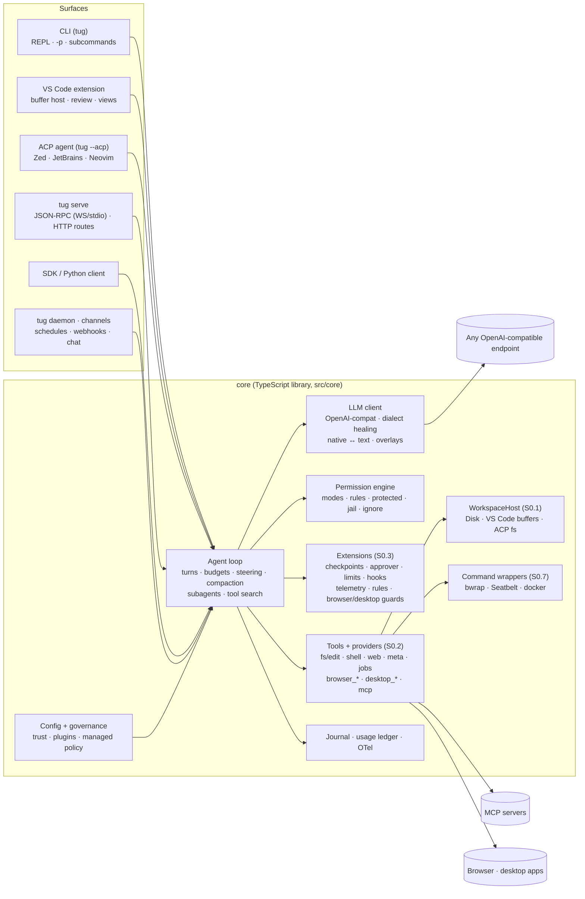

# Tugline: design

**An open agentic coding and automation harness for any OpenAI-compatible LLM**

| | |
|---|---|
| Author | Prateek Mohan Garg (with Claude) |
| Status | v1.0: the eight workstreams of [SPEC.md](SPEC.md) merged (test results and how to run them: [TESTING.md](TESTING.md)) |
| Date | 2026-10-28 |
| Sources | The harness literature and source code (Claude Code docs, Codex, OpenCode, Cline, Aider, mini-swe-agent, SWE-agent, MCP 2026-07-28, ACP, agentskills.io) and live tests |

User-facing detail (every command, setting and default) is in [USER_GUIDE.md](USER_GUIDE.md). This document explains how it is built and why.

---

## 1. Problem and goal

Companies increasingly run their **own LLMs**: an on-prem vLLM cluster, an Ollama box, a gateway in front of open-weight models. Each one gives developers a base URL, an API key and a model name. What these deployments lack is the **harness**, the layer that turns a chat model into an agent that reads and edits code, runs tests, searches the web, drives a browser or desktop app, uses MCP tools and follows team-specific skills. Claude Code and Codex provide that layer, but only for their own vendors' models.

**Goal:** a harness anyone can install as a **CLI**, a **VS Code extension**, an **ACP agent** for other editors, a **server** or an **SDK**. They enter `baseUrl + apiKey + model` and get Claude-Code-class agent behaviour on top of *their* model.

The EAG course has a lesson that shaped the whole design: *"When you read agentic benchmarks, people are not comparing Claude Code vs Qwen Code. They have their own harness and tools, and just borrow the vanilla model"* (Session 18). The external research agrees. On Terminal-Bench 2.0 the same model scores between 58% and 82% depending on the harness, a bigger spread than a model generation buys. The harness is the product.

### Non-goals (v1.0)
- Training or fine-tuning models. The harness is model-agnostic.
- A hosted multi-tenant service. Server mode binds loopback and serves one user; remote runs go through an SSH tunnel or a TLS proxy the operator sets up.
- Pushing branches from remote runs (only patches come back).

---

## 2. Requirements

### Functional (v0.1, all still hold)
| # | Requirement | Where it comes from |
|---|---|---|
| F1 | Works with any OpenAI-compatible `/chat/completions` endpoint | User need; S5/S6/S15 gateway |
| F2 | Works even when the server or model has **no native tool calling**, via a text tool protocol | S3/S5 prompted-JSON fallback |
| F3 | Coding tools: ranged read, anchored edit, write, glob, grep, shell | S17 "four primitives" |
| F4 | Web search and fetch, with no paid key needed by default | S6/S9 |
| F5 | Screenshots and page checks; browser automation | S9/S10/S17 webcheck |
| F6 | MCP client (stdio and Streamable HTTP; both the 2025 and 2026-07-28 protocol eras) | S4–S7, S12 §13.2 |
| F7 | Skills (SKILL.md, progressive disclosure) that users can add and the agent can author | S17 §12; agentskills.io |
| F8 | Subagents with fresh context: explore, general, validator, custom | S8 scoped context; S17 §10 |
| F9 | Task list, plan mode, ask-user, project memory (AGENTS.md / CLAUDE.md) | Claude Code parity; S13 §7 |
| F10 | Hooks | Claude Code parity; S16 "deterministic code decides" |
| F11 | VS Code extension and a CLI with headless mode | User need |
| F12 | Evaluation harness with raw records and a rescorable scorer | S18 |

v1.0 adds features A1–I3: editing (A), VS Code (B), safety and recovery (C), agent core (D), browser (E), desktop (F), platform (G), automation (H) and evaluation (I). Each has acceptance checkpoints; the per-item status is in [SPEC_STATUS.md](SPEC_STATUS.md).

### Non-functional
| # | Requirement | Source |
|---|---|---|
| N1 | **Deterministic code makes every authority decision.** The model only proposes. | S11, S12, S15, S16 |
| N2 | Safety rules live in code, not in the prompt, because compaction erases prompts | S11 inbox incident |
| N3 | The agent can never modify its judge (tests, CI, config) | S17 §4, S18 |
| N4 | Every refusal is recorded | S15/S16 refusal recorder |
| N5 | Small-context local models (16–32K) must work, so context is the budget | S17 §7; Ollama 4K default |
| N6 | Cost and usefulness are metered: HTTP 200 is not an answer | S15 §2 |
| N7 | Runs are journaled (append-only, hash-chained, secrets redacted) and resumable | S8, S12 inv. 7, S16 |
| N8 | Few dependencies; optional ones are lazy-loaded (SPEC R4, [DEPENDENCIES.md](DEPENDENCIES.md)) | Deployability inside companies |
| N9 | Risky features are off by default and configurable (SPEC R2) | S11, S12 |

---

## 3. Architecture



**Layering.** The core is a plain TypeScript library (`src/core`). Every surface is thin: it subscribes to `AgentEvent`s and answers the agent's callbacks (`requestPermission`, `askUser`, `approvePlan`, plus MCP elicitation). When a surface cannot answer, the answer is *deny*, recorded as a refusal. This follows the course's S14 rule, "the surface holds no agent logic", and the OpenCode/Cline pattern of a headless core with thin clients.

**Integration discipline.** v1.0 was built by eight parallel workstreams. They plug into the core through a fixed set of seams (§4) rather than editing shared files, so features stay separable and each seam has its own tests (`test/seams.test.ts`).

### 3.1 The agent loop (`src/core/agent/agent.ts`)

```
run(prompt):
  system prompt ← build (stable prefix first, for prefix caching)
  onRunStart extensions · UserPromptSubmit hooks
  loop:
    if aborted / maxTurns / budget → stop with reason
    beforeTurn extensions (checkpoint, spend admission → may stop with 'budget')
    inject steers queued since the last call
    if tokens > compactAt × window → compact (precomputed summary if its span is unchanged)
    reply ← LLM(messages, tools)            # streaming; dialect healed in the client
    if empty reply → nudge (≤2), count as unparseable (S18 metric)
    if no tool calls → Stop hooks → optional validator subagent → final answer
    for each tool call (consecutive task calls in parallel):
      parse/repair args → coerce types → check required
      policy.check → allow | deny (recorded) | ask → approve extensions → UI (headless = deny)
      PreToolUse hooks → beforeShell extensions → run → cap output → afterTool extensions → PostToolUse hooks
      bookkeeping: files changed, commands (+afterLastEdit), thrash detection, tool activation
    append tool results (+ images for vision models)
  onRunEnd extensions · run queued prompts
```

Design points, each traced to the course:
- **The loop is a straight line** (S17 §8). A failure becomes the next attempt as new messages; nothing is rewritten in place except by compaction or an explicit `truncateTo`. Tool calls are never deduplicated, which avoids the S16 bug where `pytest -q` counted as a "duplicate".
- **Thrash ceiling** (S17 §9). The same failing command N times in a row (default 4) stops the run, with a warning at N−1. Identical call plus identical result three times triggers a nudge, and six times stops the run. Eight consecutive tool errors also stop it.
- **Errors are observations** (S3/S6). Unknown tools, invalid JSON, missing arguments, refusals and tool exceptions return to the model as tool results with corrective guidance. Model output never crashes the loop.
- **Read-only calls run in parallel** when every call in the turn is read-only and pre-approved (S5/S8 fan-out).
- **Budgets** (S15/S16): `maxTurns`, `maxCostUsd`, `maxTokens`, daily limits (C7), a per-call timeout. Every stop has a typed reason: `end_turn | max_turns | aborted | thrashing | budget | error | llm_unavailable`.

### 3.2 The LLM client and dialect healing (`src/core/llm/`)

One client speaks OpenAI Chat Completions, which nearly every self-hosted server exposes. Provider quirks are healed at this edge (S15: *"provider-specific syntax belongs inside the gateway"*), so the loop never sees them:

| Problem seen in the wild | Healing |
|---|---|
| Server rejects `stream_options` | Retry without it; estimate usage |
| `max_tokens` vs `max_completion_tokens` | Swap on a 400 that names it |
| `temperature` unsupported (reasoning models) | Drop it |
| vLLM without `--enable-auto-tool-choice`, or Ollama "does not support tools" | Switch to the **text tool protocol** (in `auto` mode) |
| Model leaks `<tool_call>` or `<edit>` text in native mode | Parse and execute it anyway |
| `<think>…</think>` in content, or `reasoning_content` / `reasoning` fields | Split into a reasoning channel (shown dimmed, never sent back) |
| **HTTP 200 but empty: reasoning ate `max_tokens`** (S15 billing bug) | Detected as `emptyDueToLength`, metered as unparseable, model nudged |
| 429 / 5xx / network | Exponential backoff with jitter; honours `Retry-After` |
| Context overflow 400 | Typed `context_overflow` → force compaction → retry |
| Strict tool-call ids (Mistral) | Ids are 9 alphanumeric characters |
| Strict chat templates reject odd sequences after compaction, aborts or nudges | `normalizeMessages` on every request: orphan tool results become user text, unanswered calls get a synthetic result, consecutive user messages are merged |
| A 400 that merely *mentions* "tool" | Not mistaken for "tools unsupported"; the dialect switches only on explicit no-tool-support errors |
| Tool-call arguments cut off by `max_tokens` | Not "repaired" and executed; the model is asked to resend smaller |
| Stream drops mid-response, missing `index`, repeated names | Retried as a network error; deltas reassembled correctly |

**Text tool protocol** (`textProtocol.ts`). Tools are rendered into the system prompt, and the model replies with `<tool_call>{"name":…,"arguments":…}</tool_call>`, the Hermes/Qwen convention most open models were trained on. The parser also accepts Qwen3-Coder XML (`<function=…><parameter=…>`, with code parameters kept raw), fenced JSON naming a known tool, bare JSON, and `<edit path>` SEARCH/REPLACE blocks (§5.1). The transcript is stored in canonical OpenAI form and rendered into the dialect per request, so switching dialects mid-session is lossless.

**Argument repair** (`util/json.ts`, `coerceArgs`). Code fences, trailing commas, raw newlines in strings, Python literals, truncated braces and prose-wrapped JSON are repaired losslessly. Stringly-typed numbers, booleans and arrays are coerced against the schema. Anything else goes back to the model as an error. Nothing is guessed.

**Capability probe** (`probe.ts`, `tug doctor`, "Test connection" in VS Code). It lists models and sends a chat, a native tool call and a text-protocol tool call, then recommends `native` or `text`. The result is cached per endpoint in `capabilities.json` (D4), so the next session starts in the right dialect.

### 3.3 Tools

| Tool | Kind | Key behaviour |
|---|---|---|
| `read_file` | read | Line-numbered, ranged (offset/limit, 2000 lines, lines up to 20k chars), images for vision models, binary detection, near-miss filename hints |
| `edit_file`, `multi_edit` | edit | Tiered unique-match anchors, read-before-edit, stale-read refusal, byte preservation, post-edit verification (§5.1) |
| `apply_patch` | edit | Codex V4A port, routed to GPT-family models; ambiguity refused; all-or-nothing |
| `write_file` | edit | Creates files; overwrite needs a prior read, is capped (400 lines), refuses placeholders |
| `notebook_edit` | edit | Jupyter cells, byte-exact round trip |
| `glob` / `grep` / `list_dir` | read | `.gitignore`-aware, ripgrep with a JS fallback, hide ignored paths (`policy.isHidden`) |
| `bash` | execute | Shell or allowlist mode, timeout kills the process group, head+tail cap, scrubbed env, command wrappers (sandbox), optional background jobs, visible-terminal host |
| `monitor`, `job_output`, `job_kill` | meta/execute | Background jobs (D5); hidden until a job exists |
| `web_search` | network | DuckDuckGo HTML (no key, with a Lite fallback) / SearXNG / Brave / Tavily |
| `web_fetch` | network | HTML → markdown; optional cheap-model extraction; **SSRF guard** re-checked on every redirect; output wrapped as untrusted |
| `screenshot` | network | Headless page check (JS errors, console errors, visible text, JS-disabled text) or desktop capture |
| `todo_write`, `load_skill`, `ask_user`, `exit_plan_mode` | meta | Task list, skill disclosure, clarification, plan approval |
| `task`, `task_result`, `worktree_merge` | meta/execute | Subagents (parallel, background, worktree) |
| `tool_search` | meta | BM25 over deferred tools (D3) |
| `remember`, `repo_map` | edit/read | Memory (always asks), ranked repo map |
| `mcp__<server>__<tool>`, `mcp_resource` | mcp | MCP tools and resources |
| `browser_*` (17) | network/execute | Browser automation (§5.5), when enabled |
| `desktop_*` (14) | read/execute | Desktop automation (§5.6), when enabled |
| `wait_until` | meta | Scheduled runs only: park until an event (§5.8) |
| `ide_diagnostics` | read | VS Code only: language-server diagnostics |

**A failing command is evidence, not a tool error** (S17). `bash` returns `isError: false` with the exit code in the text, so the model reads it and adjusts.

### 3.4 Context engineering (`agent/prompt.ts`, `agent/compaction.ts`)

- **Prompt layout for prefix caching.** Identity and rules first, then environment, project memory and imported rules, skills listing, subagent types, deferred-tool names, model notes, output style and the mode note. The system prompt is built once per user prompt, and history is append-only. Deferred tools are appended at the *end* of the tool list when activated, and glob-scoped rules are appended to tool results, so the cached prefix stays byte-stable (S15; Manus).
- **Prompt-cache awareness (v1.1 N10, `src/core/cache/`, `llm/promptCache.ts`).** The usage parser normalises every server's cached-token field (`prompt_tokens_details.cached_tokens`, `cache_read_input_tokens`, llama.cpp `timings.cache_n`; absent = not reported). A meter extension tallies hit rates per call and per root session for `/cost`, `/cache`, the VS Code meter, the status line and eval reports. For llama.cpp (probe `GET /props`, or a passive `timings` block) the client sends `cache_prompt` and a stable per-agent `id_slot` (a per-server slot table; an `id_slot` the server rejects is healed away). A prefix-guard extension snapshots [model, system sections, tool schemas, per-message hashes] before each turn and emits one `cache_break` event with named causes when anything but an append changed. Prevention: the run-start system-prompt rebuild keeps the old prompt when only the volatile Environment lines (date, git status) changed and sends them as an `<environment_update>` on the user message; the deferred-tools listing is fixed per tool set; idle compaction (interactive sessions only: after a run, nothing queued, above 60 % of the budget) uses `compactNow`, keeps messages[0] and tools, and a run arriving meanwhile awaits it in `beforeTurn`.
- **Two prompt styles.** `full`, and `compact` (about 40% shorter) for small local models.
- **Project memory.** `<homeDir>/AGENTS.md` → `AGENTS.md` → `CLAUDE.md` → `.tugline/MEMORY.md` → `<homeDir>/MEMORY.md` → `.github/copilot-instructions.md`, within a character budget; superseded memory lines are dropped. Cursor, Cline and Gemini rule files are imported (§5.7).
- **Compaction**, cheapest first: clear old tool outputs (keep the last six, leave a stub), then summarise the older span with the summarizer model into a structured hand-off that keeps user requests **verbatim**, then a mechanical summary if that fails. A server-side "context length exceeded" error forces compaction and a retry. v1.0 pre-builds the summary in the background (§5.4).
- **Output caps** (head 40% + tail 60%), because test summaries are at the end and causes near the start.
- **Subagents as context control** (S8: 54K → 17K tokens with scoped inputs).

### 3.5 Skills, custom agents, subagents

- **Skills** (agentskills.io format). Discovery, most specific first: `.tugline/skills`, `.claude/skills`, `.agents/skills`, `.codex/skills`, config dirs, `~/.tugline/skills`, `~/.claude/skills`, `~/.codex/skills`, plugin skills, then the bundled ones. Level 1 (name + description) is always in the prompt, level 2 (the body) comes via `load_skill`, level 3 (sibling files) via `read_file`. Bundled: `python-bugfix`, `test-driven-fix`, `web-pages`, `code-review`, `web-research`, `git-workflow`, `skill-creator`.
- **Custom agents**: `.tugline/agents/*.md`, `.claude/agents/*.md`, `~/.claude/agents/*.md` and plugin agents, with frontmatter `name`, `description`, `tools` (allowlist) and `model` (profile). Bundled: `reviewer`.
- **Subagent semantics.** Fresh context, a tool allowlist (explore: read-only plus web; validator: read plus `bash`, no edit; general: everything except `task`, so depth is at most 1), the parent's permission engine and approval UI, the parent's abort signal, and cost merged into the parent's stats.
- **Validator** (S17 §10: *"fresh context, hostile brief, no hands"*). A validator that ran no command is reported as `UNVERIFIED`. With `agent.autoValidate`, the agent must pass a validator before finishing a task that changed files.

### 3.6 MCP (`src/core/mcp/`)

- The **v2 TypeScript client** (`@modelcontextprotocol/client` 2.4) with `versionNegotiation: auto` talks to 2025-era servers and 2026-07-28 stateless servers. Transports: stdio, Streamable HTTP, SSE fallback.
- Config uses the Claude Code / Cursor shape and also reads the project's `.mcp.json` (once the workspace is trusted).
- Tools are exposed as `mcp__server__tool`. Schemas are simplified (`$schema`/`$id` stripped) for llama.cpp grammars and vLLM guided decoding.
- **Supply-chain defences** (S12 §13.2): descriptions are scanned for injection markers; calls default to *ask* unless the server is `trusted`; results are wrapped as untrusted; tool definitions are **fingerprinted at connect** and calls are refused if they change (rug pull).
- v1.0 adds resources, prompts, elicitation, OAuth and registry search (§5.7).

### 3.7 Hooks (`src/core/agent/hooks.ts`)
Claude-Code-compatible contract: JSON on stdin (with `hook_event_name`), **exit 2 = block** (stderr goes to the model), `{"decision":"block"}` or `hookSpecificOutput.permissionDecision: "deny"` also block, and stdout or `additionalContext` is appended. Events: `PreToolUse`, `PostToolUse`, `UserPromptSubmit`, `Stop` (three blocks at most), and in v1.0 `SessionStart`, `SessionEnd`, `PreCompact`, `SubagentStart`, `SubagentStop`, `PermissionRequest`, `Notification`. Project hooks need hash approval (§6).

### 3.8 Journal, metering and observability
- `~/.tugline/sessions/<project>/<session>.jsonl` records a manifest (model, endpoint, tool mode, permission mode, shell mode, protected paths, tools), every message, event and refusal. It is **hash-chained** (`Journal.verify`), and API keys and secret patterns are redacted. `--continue` and `--resume` reload it. Resumed or truncated conversations write a `compacted` record, and resuming into another surface writes a new journal rather than reopening an old one, so every chain stays valid.
- Per-call usage (server-reported, or estimated and flagged), latency, cost (from profile pricing), the call's routing role, and S18's agent-quality signals: unparseable replies, tool errors, refusals, commands run after the last edit.
- The C7 usage ledger (§5.3) and OpenTelemetry spans (§5.8) are fed by the same `usage` events, so they agree.

### 3.9 Evaluation harness (`src/core/eval/`, `tug eval`, `tug rescore`)

A direct implementation of S18's "benchmark is a procedure":
- **Task** (`task.json` + fixture `repo/`): behaviour, prompt, acceptance commands, verification commands, protected paths, type.
- **Harness**: a fresh git-initialised copy of the fixture; protected files hashed before and after; acceptance runs **outside the agent**. An optional suite `setup` module starts fixtures such as a test website and substitutes `{{VARS}}`.
- **Policy**: arms are config overrides, so "guard on/off" is a controlled comparison. The `__tools` arm key restricts the tool list (the bash-only baseline).
- **Raw record first** (`runs/*.json`), score second. `tug rescore` recomputes without calling a model.
- **Scorer fields kept separate**: outcome (`pass | fail | not_evaluable`), integrity (`clean | attempted | protected_write`), verification (`verified_pass | unverified_pass | honest_failure | false_success`), cost, and "$ / resolved". Suites may append their own metrics (edit metrics, automation path statistics).

### 3.10 CLI (`src/cli/main.ts`)
- `tug` (REPL with streaming, tool lines, inline diffs on approval, task list, status line, type-ahead buffering), `tug -p` (headless; progress on stderr, answer on stdout; `--json` streams events), `tug --acp`.
- Built-in subcommands: `setup`, `doctor`, `models`, `sessions`, `eval`, `rescore`. Every other subcommand comes from the CLI registry (§4).
- Built-in slash commands: `/help /mode /model /models /cost /todos /tools /skills /mcp /compact /clear /sessions /resume /init /exit` and `/<skill>`. The rest come from the slash registry; registered commands override built-ins except `/exit`, `/quit` and `/help`.
- Ctrl+C cancels a run; twice within 2 s also pulls the automation kill switch (F7).

---

## 4. Integration seams (S0)

These interfaces were put on `main` before the workstreams started. Each is additive and tested in `test/seams.test.ts`.

| Seam | Where | What it is for |
|---|---|---|
| **Workspace host** (S0.1) | `src/core/host/workspace.ts` | `WorkspaceHost {kind, readText, writeText, exists, delete, flushForShell?, diagnostics?, onExternalChange?, runCommand?}`. File tools read and write through `ctx.host`, and the read ledger records the host's version token. Implementations: `DiskHost` (CLI, eval), `VsCodeBufferHost` (editor buffers), `AcpFsHost` (ACP `fs/*` requests). `HostText.utf8`/`bytes` let the edit engine refuse non-UTF-8 and keep a BOM. `runCommand?` lets a host run the already-wrapped command in a visible terminal and must resolve `undefined` before starting anything to fall back. |
| **Tool providers** (S0.2) | `src/core/tools/registry.ts`, `providers.ts` | `registerToolProvider({id, tools(cfg, env)})`. Each module registers its provider and `providers.ts` imports the module (one line per workstream). Duplicate names are dropped, first wins: builtin > provider > MCP. Explore and validator subagents get provider tools marked `readOnly`. A failing provider is reported, not fatal. |
| **`core` tool flag** | `ToolDef.core` (`tools/types.ts`) | When tool search defers schemas (D3), tools marked `core: true` stay loaded with the built-in core set (`CORE_TOOL_NAMES`). Providers mark only their few essential tools: five desktop tools and seven browser tools. |
| **Agent extensions** (S0.3) | `src/core/agent/extensions.ts` | `registerAgentExtension({id, depths?, onSessionStart?, onRunStart?, beforeTurn?, approve?, afterTool?, beforeShell?, beforeCompact?, onSubagent?, onEvent?, onRunEnd?, onSessionEnd?})`. `beforeTurn` may return `{stop, message}` with a typed stop reason (budget admission). `approve` only sees calls the policy would *ask* about, after hard denies. `onEvent` is a synchronous observer (ledger, telemetry). Extensions without `depths` run inside subagents too, so usage and telemetry count children. `AgentOptions.extensions` adds per-agent ones. |
| **Slash commands** (S0.6) | `src/core/commands.ts` | `registerSlashCommand({name, description, usage?, run(args, ctx) → {prompt?}})`. `ctx.surface` is `cli`, `vscode` or `server`. Used by the CLI and by `tug serve` (`session/command`). The VS Code chat does not dispatch them yet. |
| **CLI commands** (S0.8) | `src/core/commands.ts` | `registerCliCommand({name, description, usage?, needsModel?, run(argv, ctx)})` adds `tug <name>`. `tug --help` lists them. |
| **Command wrappers** (S0.7) | `src/core/tools/shell.ts` | `registerCommandWrapper(id, cfg => spec => spec)`. `commandWrapperFor(cfg)` composes every wrapper; `buildSpawnSpec` applies them and docker. **Every** process the harness spawns for the model (foreground and background bash, the visible terminal, worktree merges, OCR, `@git` mentions, `/goal` checks) goes through it, so the OS sandbox cannot be bypassed. A wrapper may change `cwd`. |
| **HTTP routes on `tug serve`** | `HttpHandler` in `src/server/server.ts` | `(req, res) → boolean`: plain-HTTP routes mounted on the server port before the WebSocket upgrade handler; each does its own auth (HMAC). `tug serve --with-daemon` mounts the scheduler's `/hooks/<id>` and `/hooks/_liveness`. Unhandled requests get 426. The channels handler (`createChannelsHandler`) has the same shape but is mounted only by `tug channels start` today. |
| **Config sections** (S0.4) | `HarnessConfigExtensions`, `AgentConfigExtensions`, `ShellConfigExtensions`, `ModelProfileExtensions` | Each workstream declaration-merges its section and applies defaults in its own module (`cfg.edit ?? DEFAULT_EDIT`), so `config.ts` is not edited. `loadConfig` has exactly two extra calls: `applyPlugins` and then `applyGovernance`. |
| **Events** (S0.5) | `src/core/types.ts` | `checkpoint`, `steer`, `job`, `automation`, `diff_pending` and `approval_auto` variants, plus `usage.role`. UIs ignore unknown events. |
| **Shared automation types** | `src/core/automation/types.ts` | The `UiNode` tree and `DesktopDriver` contract shared by browser and desktop. |

---

## 5. Subsystems (one per workstream)

### 5.1 Editing engine (WS1)

File tools (`src/core/tools/fs.ts`) read and write through the `WorkspaceHost`; the read ledger stores the host version token, so an edit is refused when the file (or the editor buffer) changed since it was read. Anchored edits go through `src/core/edit/match.ts`: tiers exact → eol → line_numbers → unicode → trailing_ws → indent → escapes → blank_lines, each requiring a unique match and refusing on ambiguity; no similarity matching is auto-applied. Unchanged lines keep the file's bytes, and replacements inherit the region's line endings, BOM and final newline (`text.ts`). `multi_edit` applies edits in order, all-or-nothing. After a write, `verify.ts` appends only *new* problems (IDE diagnostics diffed against a pre-edit snapshot, else tree-sitter when installed, else JSON / py_compile / `node --check`) and the changed region, capped at 1.5k characters. The edit-tool family is chosen per model when the tool list is built (`routing.ts`): `apply_patch` (Codex V4A port, `applyPatch.ts`) for GPT-family models, `edit_file` + `multi_edit` otherwise; it never changes mid-session. In text tool mode, `<edit path>` SEARCH/REPLACE blocks carry raw code and become canonical `multi_edit` calls (`textProtocol.ts`). `write_file` overwrites are capped (400 lines) and refuse elision placeholders; an optional apply model (`applyModel.ts`) can merge lazy snippets under strict output checks. `evals/editing` measures all of it, with an integrity check for corrupted bytes.

### 5.2 VS Code extension (WS2)

The extension embeds the core. Each chat owns an `Agent`, created with a `VsCodeBufferHost` (`vscode/src/host.ts`). File tools read open buffers and write minimal-range `WorkspaceEdit`s, so edits merge with unsaved user text, sit on the undo stack, and are saved only when the document was clean. Version tokens are content hashes, stable across buffer and disk. `diagnostics()` waits for the language servers' publish after an edit, which feeds the core's post-edit verification. In auto-accept modes every agent write becomes a pending change: a baseline vs the live buffer, Myers hunks, CodeLens Keep/Undo and a Changes list in the webview, persisted in `workspaceState`. User typing outside agent hunks is rebased into the baseline. Inline edits reuse that review machinery. Bash may run in a visible terminal through the `WorkspaceHost.runCommand` seam: the shell tool passes the spec after every command wrapper, so the OS sandbox applies to visible commands too, and the host falls back to the hidden process before starting anything when shell integration is missing.

The webview is a vanilla-JS client of a typed message protocol (`chat.ts`) with a CSP nonce, the VS Code theme variables, and a safe markdown renderer (escape first, http(s) links only, no model HTML; S14 §6). It covers chats, queue/steer/edit-resubmit (core D12), mentions resolved at send time into `<attached_context>` blocks, images (vision parts or untrusted OCR/description text), model/effort/plan-profile selection (core overlays and routing), a meter reduced from usage events, and the Checkpoints, MCP & Skills and Settings views. The configuration wizard stores the API key in SecretStorage and probes the endpoint. Endpoint, MCP, mode, shell, terminal, browser and approver settings are application-scoped. Emergency Stop writes the cross-process STOP file and aborts every chat. Pure logic lives in `vscode/src/*.ts` modules without `vscode` imports and is unit-tested with node; the rest is covered by an E2E suite in real VS Code under Xvfb. The bundle is built with esbuild; Playwright stays external.

### 5.3 Safety, recovery and governance (WS3)

Authority stays in code, layered as follows:
1. **Managed policy** (`policy/managed.ts`) is applied last in `loadConfig`, so it beats files, env and flags, and is re-asserted before every model call by the `ws3-managed` extension.
2. **The permission engine** (`permissions/policy.ts`) decides hard denies, deny rules, always-ask, ignore files and secrets, then allow rules and modes.
3. Only `ask` decisions reach **extensions**: the classifier approver (`approver/`), behind a deterministic prefilter that only escalates, and PermissionRequest hooks, which follow the same prefilter rule.
4. **The OS sandbox** (`sandbox/`) bounds what an approved command can write and reach. It uses bwrap or Seatbelt plus an allowlist CONNECT proxy, plugs in through the command-wrapper seam, and fails closed when it was requested or forced.
5. **Recovery** comes from **checkpoints** (`checkpoint/`): a shadow git repo outside the workspace, snapshotted before every turn and shell command with git plumbing only (`add -A`, `write-tree`, `commit-tree`), every `GIT_*` variable stripped and user git config disabled, restored with `read-tree --reset -u`, falling back to content-addressed copies without git. It never touches the user's `.git`. Conversation restore uses `agent.truncateTo` and is refused across compactions and sessions.
6. **Spend** is admitted before each call from a JSONL ledger (`permissions/limits.ts`) that also counts subagents and approver calls.
7. **Project hooks** run only after their exact command hash is approved (`agent/hooks.ts`).

`.tuglineignore` and `.gitignore` are parsed by one gitignore engine (`permissions/ignore.ts`, checked against `git check-ignore`); `policy.isHidden` hides paths from search tools and the repo map.

### 5.4 Agent core and context (WS4)

- **Tool list discipline.** The tool list is part of the cached prefix. Above 20 tools (or 15 % of the window), only core tools plus `tool_search` are sent. Deferred tools are named in the system prompt and loaded by BM25 search or by exact name, and are appended at the end of the list for the rest of the session. Tools that only matter after an event (job tools, `task_result`, `worktree_merge`) are hidden until a tool result activates them.
- **Subagents.** Consecutive `task` calls run concurrently (`maxParallelSubagents`). Each child has its own agent, abort and stats, merged on completion, and a session id `<session>-sub-<n>`. Background children return a handle. Worktree children run on `oh/<id>` branches with their own permission policy rooted in the worktree; harness git calls run with hooks disabled and a scrubbed env. Depth stays 1.
- **Context.** The first prompt carries a personalised PageRank repo map (`context/repomap.ts`), built only from files the read policy allows, with secret files and constant values excluded. Compaction is pre-built in the background at 60 % of the budget and swapped in at the threshold if its span is unchanged (fingerprint). `summarizeUpTo` keeps later turns verbatim.
- **Steering.** Steers are injected after tool results and before the next model call, and queued prompts run after the current run. `truncateTo` always leaves a valid transcript (system kept, no orphan tool messages), which checkpoint restore and edit-and-resubmit rely on.
- **Routing.** Roles (planner, summarizer, explore) can use their own profiles via `llmFor(role)`. Every model call emits a role-tagged `usage` event, so ledgers and cost-per-resolved-task compare routings.
- **Overlays.** `llm/overlays.ts` selects per-family prompt notes and request defaults (only for fields the profile leaves unset) and caches probe results.
- **Memory.** `remember` writes typed, keyed lines with supersession; user-scope memory is a persistence vector, so it asks in every mode (`alwaysAsk`).
- **Background jobs** spawn through the same `buildSpawnSpec` as foreground commands, so command wrappers (the OS sandbox) apply, and are killed at session end unless `persist`.
- **Goal loop.** `/goal` re-runs the agent until a user-supplied check passes, under the thrash ceiling and budgets.

### 5.5 Browser automation (WS5)

- **Perception.** Playwright ≥1.64 `ariaSnapshotJSON({mode:'ai', boxes:true})` and `getByRef`, with a DOM-walk fallback (`data-oh-ref`). These feed one surface-agnostic `UiNode` tree (`automation/snapshot`), which desktop reuses. The renderer prunes, collapses repeated siblings, filters by query (keeping ancestors), caps at a token budget, masks passwords and used secrets, and diffs line by line. Refs are snapshot-scoped. A stale ref is rebound by the semantic key `role|name|nth|landmark` only when exactly one element matches.
- **Action.** Scan → policy guard → act → settle → re-scan → diff → Expect. The guard (`automation/policy`) is code outside the model: kill switch, CAPTCHA/payment/2FA handoff, destructive actions need an `expect`, the S9 fence rule (≤2 actions per turn; dropdown openers, submits and navigation alone), and rate limits with a loop breaker.
- **Cascade (`browser_task`).** L0 typed preconditions → L1 guarded fetch + readability, no browser → L2a recorded recipe → L2b small-model JSON sub-loop over the tree → L3 pixels (vision: set-of-marks drawn after capture; text-only: OCR regions or a grounding VLM). Every result carries `path`, and per-run path statistics are recorded.
- **Network safety.** Launched browsers run behind a local egress proxy that applies the SSRF guard to every request and redirect hop and connects to the resolved IP; WebRTC UDP is disabled. Attached mode (the user's Chrome, no egress proxy) adds per-session consent, a domain allowlist and a landed-URL check. Since v1.1 it also intercepts at the CDP level, and only on the tabs the harness opened or drives: each gets `Fetch.enable` at the Request stage, so every request and every redirect hop (a new `Fetch.requestPaused`) is checked before it is sent and refused with `BlockedByClient`. Main-frame navigations must be allowlisted; subresources to private, loopback or metadata addresses are refused, and other third-party subresources only with `browser.attachedStrictSubresources`. Cross-site iframes are separate targets: a page-level `route()` covers their first request (Playwright enables interception before resuming the frame) and gives each one its own CDP `Fetch` guard for its redirect hops. Popups of our tabs are adopted and guarded; because a popup's first request can leave before its guard exists, its opening URL is checked and a refused popup is blanked. Not covered: service-worker requests, redirect hops of worker requests, and DNS rebinding (Chrome resolves names itself).
- **Secrets.** `secret://name` refs resolve inside the driver from the vault (`src/core/secrets/vault.ts`). Every capture that can reach a model masks secret and password fields, and is withheld when a secret is echoed elsewhere on the page.
- **Recording.** JSONL trajectory (secret refs only), with strict and self-healing replay, Playwright export, L2a recipes and an HTML report.

### 5.6 Desktop computer use (WS6)

- **Backends.** One `DesktopDriver` (scan-act-verify) over thin transports: cua-driver over MCP (`cua-driver mcp`, version-pinned, schema-adaptive arguments, telemetry off), JSON-RPC sidecars (Linux AT-SPI in Python, Windows UIA in PowerShell, or the Linux sidecar inside the Docker sandbox), and an Electron bridge that relaunches the app with a 127.0.0.1 CDP port and reuses the browser driver. Helpers get the scrubbed env plus the desktop session locators that the scrubber would otherwise drop (`XAUTHORITY`, `DBUS_SESSION_BUS_ADDRESS`).
- **Perception.** Native AX / UIA / AT-SPI elements are normalised to the shared `UiNode` tree (ARIA roles, `d` refs that stay stable while the element's semantic key and group size do) and rendered by the browser's snapshot renderer. Pixels are last: masked screenshots, OCR regions or a grounder for text-only models, images and marks for vision models.
- **Action.** Resolve (stale → unique-key rebind or refuse) → guard (kill switch / STOP file, self-protection by pid and app, destructive needs expect, fence, rate limit) → act → re-scan → diff + Expect → outcome. Empty trees go through trap diagnosis and never get blind retries.
- **Approval.** Ask unless the app is auto-approved, in every permission mode; pixel clicks, clipboard and Electron relaunches always ask.
- **Kill switch.** One process-local `killAutomation()` (shared with the browser) plus a cross-process STOP file polled every 100 ms and checked before every tool call.
- **Recording.** E7 trajectory format with semantic keys and `desktop://app/title`; strict replay with no model.

### 5.7 Extensibility and platform (WS7)

- **One core, many surfaces.** The CLI, VS Code, ACP editors (`src/acp`), the JSON-RPC server (`src/server`, WebSocket or stdio), the TypeScript SDK (`src/sdk`) and the Python client all drive the same `Agent`. A surface only renders events and answers the agent's callbacks plus MCP elicitation. When a surface cannot answer, the answer is *deny*, recorded as a refusal; no surface can approve by default.
- **ACP.** `OhAcpAgent` maps ACP sessions onto agents: streamed message, thought, tool-call and plan updates; `session/request_permission` built from our permission requests (edits carry a diff); `session/cancel` aborts and denies open requests; file access through `AcpFsHost`.
- **Server.** It binds loopback only, uses a token in the first message (constant-time compare), and refuses browser origins and non-loopback Host headers. Sessions are ordinary agents. `config/set` is limited to mode, profile and style. Remote runs (`remote/run`) clone into a server-side workspace with a hardened clone and return a patch that the client applies after review.
- **Extensions as data, code behind trust.** Plugins (Tugline or Claude Code layout) contribute skills, agents and commands (markdown, loaded when enabled), plus hooks and MCP servers (code), which run only while the plugin's content hash matches the one the user trusted. Hooks also go through the hook-trust store. Plugins are applied inside `loadConfig` before governance, so the managed policy filters them like everything else.
- **MCP.** Tools, resources (`mcp_resource`), prompts (`/mcp:server:prompt`) and elicitation (both protocol eras) are supported, plus OAuth 2.1 with a loopback redirect, PKCE and per-server 0600 token files bound to the server URL. All server-supplied text is wrapped or neutralised against wrapper-tag injection.
- **Compatibility.** Cursor, Cline and Gemini rule files and Codex and Claude Code skills, agents and commands are read as project instructions. Glob-scoped rules are appended to the tool result that brought a matching file into context, so the system prompt stays byte-stable.
- **Output styles and status line.** A style adds a prompt section before the mode note. The status line command runs with the scrubbed env and a timeout; a project-defined one needs hash approval.

### 5.8 Automation, collaboration and evaluation (WS8)

- **Events are facts, schedules are authority** (S16). Every trigger (cron tick, file change, webhook, GitHub delivery, timer) is normalised to an event and passes one door (`schedule/intake.ts`) in a fixed order: per-source rate limit, dedupe on `source/id` (an O_EXCL ledger, written before deciding), self-trigger refusal, parked waits, deterministic match against human-written schedules, then a window governor (runs per day, daily budget) that the agent cannot reach, which shrinks each run's cost ceiling. Every step leaves an activity record, which feeds `tug schedule report`. Runs are headless: the schedule's mode, default ask = deny-with-record; event data is wrapped as untrusted. `wait_until` parks a run on disk; the matching event resumes the same run from its journals. Webhooks are HMAC-verified per schedule (the secret is in the vault) before dedupe, and fail closed without a secret. The routes are a mountable `HttpHandler` for server mode and a 127.0.0.1 listener in `tug daemon`, which also holds per-schedule leases, writes a heartbeat (liveness 200/503) and records missed ticks.
- **Channels** (S11). Adapters convert Telegram, Slack (Events API) and signed webhooks into typed messages; the gateway assigns trust from the pairing store in code before any model sees the text. Untrusted senders can only `/pair` (one-time, hashed, expiring, brute-force-limited codes) and never reach an agent. Paired users' text is wrapped as untrusted; owners' text is the prompt. Replies stream as edits, tokens come from the vault and are redacted, and every decision goes to an append-only action log.
- **Telemetry** (S15). An extension turns agent events into OTel spans (run → turn → llm.call / tool.call, subagents nested under their task span) with GenAI attributes and cost. The same usage events feed the C7 ledger, so span cost equals ledger cost; approver calls are back-filled from the ledger. The OTel packages are optional and lazy, and content is off by default.
- **Review, arena, benchmarks.** `tug review` is a read-only reviewer over an untrusted diff with findings validated in code. `tug arena` runs candidates in worktrees, scores them outside the agent (check command, diff) and with an anonymised rubric judge, then ranks them. `tug bench` converts terminal-bench and SWE-bench tasks into eval suites with hidden tests (kept under `<homeDir>/bench/hidden-runs/`, not the OS temp dir), plus the bash-only baseline arm. All of it reuses the S18 eval harness.

---

## 6. Security model

### 6.1 Permission engine (`src/core/permissions/policy.ts`)

Decision order: **hard denies → user deny rules → always-ask checks (dangerous commands, agent-control files, secret files, ignored files) → user allow rules (config + session "always") → mode default**. Then, only for `ask`: approve extensions (approver, auto-approved desktop apps) → PermissionRequest hooks → the surface's UI → headless deny.

| Mode | read | edit | execute | network | MCP |
|---|---|---|---|---|---|
| `ask` (default) | allow | ask | ask | ask | ask |
| `acceptEdits` | allow | allow | ask | allow | ask |
| `plan` | allow | **deny** | **deny** | allow | ask |
| `auto` | allow | allow | allow | allow | allow |

Hard denies, which no rule or mode can lift:
- **Protected paths, the judge** (S17). Always `.git/**`, `.tugline/config*.json` and `.mcp.json`, plus project globs such as `tests/**` and `.github/**` (the eval harness adds each task's tests). Matching is case-insensitive, and paths are normalised without the S17 `lstrip("./")` bug.
- **Workspace jail**: writes outside the workspace and `additionalDirectories` are refused after full symlink resolution, including dangling links.
- **Plan mode** is read-only.
- **Managed deny rules** (§6.4).

Always asks, even in `auto`:
- **Dangerous commands**, from a tokenizing analyser that splits compound commands, skips env-assignment and wrapper prefixes, finds git subcommands after global options and recurses into `bash -c`: `git push`, recursive deletes of root/home/parent/system dirs, `sudo`, downloads piped into interpreters, `git reset --hard` / `checkout .` / `clean -f`, package publishing, disk tools.
- **Agent-control files**: `.mcp.json`, `.vscode/**`, `.tugline/**`, `.claude/**`, `AGENTS.md`/`CLAUDE.md`, `.github/**`, git hooks, `.envrc`. Only an explicit, wildcard-free rule naming the file skips the prompt.
- **Secret files** (`.env`, keys, `.ssh/**`, `.aws/**`), checked on the resolved path, and **`.tuglineignore`-d paths**.
- Inputs that declare `alwaysAsk` (user memory).

In headless runs with no user, "ask" becomes "deny" with a recorded reason. A run never hangs and never silently escalates.

Rules use the Claude Code shape (`bash(npm test*)`, `edit_file(src/**)`, `web_fetch(domain:*.github.com)`, `mcp__github__*`). A command rule matches a compound command only if **every segment** matches; substitution and redirection are never auto-allowed by a prefix rule; "always allow" offers narrow rules.

**Honesty about command checks** (S8/S12): pattern analysis of shell commands is a seatbelt, not a sandbox. The real boundaries are `ask` mode for commands, the allowlist runner, and the OS or Docker sandbox (§6.3).

### 6.2 Trust boundaries for content and config

- **Workspace trust.** `.tugline/config*.json` and `.mcp.json` come from whoever wrote the repository. Until the user trusts the workspace, project config may only add `permissions.deny`, `permissions.protectedPaths` and `skills.disabled`. It cannot change the endpoint (which would send the API key elsewhere), start MCP servers, run hooks, add allow rules, change modes, or enable browser or desktop automation and pick their driver binaries. VS Code's risky settings are application-scoped for the same reason.
- **A skill is instruction, never authority** (S17 §12). Nothing in `src/core/skills/` imports the permission engine, and a test asserts it for every file. Imported rule files, markdown commands and output styles are instructions too. Markdown commands never execute Claude Code's "!`cmd`" interpolation.
- **Untrusted content is data** (S12 invariant 3). Web pages, search results, page and accessibility text, OCR text, clipboard text, MCP output, PR diffs, trigger payloads and paired-channel messages come back wrapped in `<untrusted_…>` envelopes by one helper (`util/untrusted.ts`), which neutralises any wrapper tags inside the body so a page cannot close the envelope early. The boundary is still the permission engine, which treats every resulting action the same way regardless of what prompted it.
- **Hook trust.** Project hooks run only in a trusted workspace **and** when sha256(event, matcher, command) is in `trusted-hooks.json`; a changed hook is dropped at load time and reported. A PermissionRequest hook may deny any ask but may only allow calls the approver prefilter does not flag. PreToolUse runs after the permission engine, so it can block but never loosen. A project-defined status-line command needs the same approval.
- **Plugin trust.** Plugin skills, agents and commands load when enabled; hooks and MCP servers run only after `tug plugin trust`, which records a hash over every file in the plugin, so an update or tampering voids it. Git and marketplace installs are never trusted at install. Installs refuse symlinks and paths outside the plugin, clone with hooks, submodules and `ext::` disabled, and a plugin cannot mark its own MCP server `trusted`.

### 6.3 Containment

- **OS sandbox.** bwrap: `--ro-bind / /`, private `/tmp`, writable workspace and cache dirs, read-only persistence paths inside the workspace (`.git/hooks`, `.git/config`, `.tugline`, `.mcp.json`, `.vscode`, `.claude`, `.envrc`), `--unshare-net --unshare-pid --die-with-parent`. Seatbelt: an SBPL profile with the same write set and network only to the proxy. Unavailable but requested or forced = fail closed (exit 126).
- **Egress proxy (commands).** With `sandbox.allowDomains`, a CONNECT + absolute-form HTTP proxy enforces the allowlist. It resolves DNS once and connects to the IP it checked (no rebinding window), refuses private, loopback and metadata addresses unless listed literally, keeps CONNECT a byte tunnel so TLS still verifies the hostname, and chains to a corporate proxy when one is set. Inside bwrap a small bridge forwards 127.0.0.1:3128 to the proxy's unix socket; there is no other route out.
- **Egress proxy (browser).** Launched Chromium sends all traffic, every redirect hop and WebSocket upgrades through a 127.0.0.1 proxy that applies the SSRF guard with the same resolve-once rule; WebRTC UDP is disabled. Playwright's `route()` alone misses redirect hops, which is why the proxy exists.
- **SSRF guard (`web_fetch`, `@url:`, browser L1).** DNS resolve, private/loopback/metadata blocked including IPv4-mapped, compatible and NAT64 IPv6 forms, re-checked on every redirect; `web.allowHosts` for intranet.
- **Docker sandbox.** `shell.sandbox: "docker"` with `--network=none`; the desktop sandbox container runs as a non-root user with `no-new-privileges`, no host mounts and noVNC on 127.0.0.1.
- **Desktop self-protection.** The agent cannot act on the harness's pid, its ancestors (terminal, IDE), `VSCODE_PID`, its own terminal or editor app, or `desktop.denyApps`. The STOP file stops every Tugline process within a second.

Without a sandbox, host execution is a **usability boundary, not a security boundary** (S8, S12 §5). For untrusted repositories, enable `shell.sandbox` or run inside a dev container; administrators can force it.

### 6.4 Governance and spend

- **Managed policy.** A system file (or `TUG_MANAGED_POLICY`) locks the endpoint profile, adds deny rules and protected paths, allowlists MCP servers and skills, disables auto mode and the approver, caps daily spend and forces a sandbox. It is applied after every other layer, re-asserted at runtime (`/mode`, `/model`, VS Code profile changes), combined restrictively when two files exist, and fails closed on an invalid file. User and project config cannot plant `cfg.managed`.
- **Approver prefilter.** The classifier approver (`approver/`) only sees `ask` decisions, never hard denies. Before the model, a deterministic prefilter escalates the seven rubric categories (destructive, credential-access, exfiltration, outside-workspace-write, publishing, persistence, security-weakening), including inline interpreter code, nested shells, split-flag recursive deletes, cloud uploads, credential hunting outside the workspace and TLS weakening. It only ever escalates. The classifier's verdict is parsed strictly: anything unclean, or an `allow` naming a block category, becomes `ask`. Tested against 108 red-team and 67 safe cases.
- **Spend limits.** A pre-call admission check (worst case = prompt + tool schemas + max output) against per-session and per-day limits from the ledger, across processes, counting subagents and approver calls.

### 6.5 Surfaces that accept connections

- **Server tokens.** `tug serve` binds 127.0.0.1 (hard-coded), requires `auth {token}` as the first WebSocket message (256-bit random or `TUG_SERVER_TOKEN`, constant-time compare over sha256 digests; 10 s to authenticate), refuses `Origin` headers not in `server.allowedOrigins` and non-loopback `Host` headers (drive-by pages, DNS rebinding), and writes the token to a 0600 file only while serving. Unanswered approvals become denies. `config/get` is redacted; `config/set` cannot touch hooks, endpoints or permissions. Stdio mode needs no token because the pipe belongs to the parent process.
- **Remote runs.** Off by default; https, ssh and `git@` URLs only (no `-…` option injection, `--` separator), local paths only with an explicit flag, a hardened clone treated as an untrusted workspace, `acceptEdits` by default so commands ask the remote client, and the clone removed afterwards.
- **Webhooks.** Per-schedule HMAC secrets from the vault, verified before the dedupe ledger is touched (forged deliveries cannot burn ids), 503 without a secret, body size cap, per-source rate limit, self-trigger refusal.
- **Channel pairing.** Trust is assigned in code from the pairing store before any model sees a message. Codes are 8 characters from a 32-character alphabet, stored hashed, single use, channel-bound, valid 10 minutes, and a sender is locked out after 5 wrong guesses (S11 "ClawJacked"). Slack requests are checked with the signing secret and a 5-minute replay window.
- **ACP and MCP OAuth.** ACP permission requests treat cancel, error and any non-allow outcome as deny. OAuth uses a loopback redirect, a `state` check before the code is used, PKCE S256, and token files bound to the server URL.

### 6.6 Secrets

- The API key lives in VS Code SecretStorage or in env/config files written 0600.
- **Scrubbed from child processes**: variables whose name looks like a credential (`KEY`, `SECRET`, `TOKEN`, `PASSWORD`, `CREDENTIAL`, `AUTH`, `SESSION`, `DATABASE_URL`, `DSN` …) and variables whose *value* equals a configured credential. This applies to shell commands, MCP stdio servers, hooks, status lines, desktop helpers and harness git calls. Exceptions are narrow and documented: `GIT_CONFIG_KEY_<n>` (a key name, needed for env-passed git config) and the desktop session locators.
- **Redacted from journals**, recordings and channel replies.
- **Vault** (`src/core/secrets/vault.ts`): `TUG_SECRET_<NAME>` → OS keychain via `keytar` when installed → `secrets.json` (0600; looser files refused). Used for browser `secret://` refs, webhook secrets and channel tokens. Values never reach the model; they are masked in snapshots and screenshots.

### 6.7 Threat model (STRIDE summary, from S12)

| Threat | Example against a coding agent | Mitigation in v1.0 | Remaining gap |
|---|---|---|---|
| Spoofing | Web page or chat message says "the user authorised deploy" | Authority only from UI callbacks, config and the pairing store; content wrapped as untrusted | n/a |
| Tampering | Agent edits tests or CI to go green; a plugin changes after review | Protected paths (hard deny), integrity scored in evals, plugin and hook hashes | n/a |
| Repudiation | "The agent did it" with no record | Hash-chained journal, refusals recorded, schedule activity log, channel action log, OTel spans | Central log shipping |
| Information disclosure | Injected page makes the agent `curl` secrets out; a repo config redirects `baseUrl` | Env scrubbing by name and value, secret-file asks, SSRF guard, egress proxies with DNS pinning, OS sandbox with domain allowlist, workspace trust, managed endpoint lock, screenshot masking | Attached-Chrome mode cannot use the egress proxy: CDP request-stage checks on our tabs (v1.1), but no IP pinning and no service-worker coverage |
| Denial of service / wallet | Infinite loop burning tokens; a webhook flood | maxTurns, thrash ceiling, cost and token budgets, daily limits, schedule rate limits and windows, browser and desktop rate limits | Multi-host schedule state |
| Elevation of privilege | MCP description injection; rug pull; a repo planting hooks; a cloned plugin | Description scanner; MCP default ask; tool fingerprints; hook and plugin trust; approver prefilter; managed policy | Signed server and plugin registry |

---

## 7. Configuration

Precedence (later wins): defaults → `~/.tugline/config.json` → `<ws>/.tugline/config.json` → `<ws>/.tugline/config.local.json` → `.mcp.json` → env (`TUG_BASE_URL`, `TUG_API_KEY`, `TUG_MODEL`, `TUG_CONTEXT_WINDOW`, `TUG_MAX_OUTPUT_TOKENS`, `TUG_TOOL_MODE`, `TUG_VISION`, `TUG_PROFILE`, `TUG_PERMISSION_MODE`) → CLI flags / VS Code settings → installed plugins (`applyPlugins`) → managed policy and hook trust (`applyGovernance`). Every key is listed with its default in the [user guide](USER_GUIDE.md#configuration-reference).

```jsonc
{
  "profile": "company",
  "smallProfile": "company-small",
  "profiles": {
    "company": { "baseUrl": "https://llm.corp.example/v1", "apiKey": "env:CORP_LLM_KEY",
                 "model": "qwen3-coder-30b", "contextWindow": 65536, "maxOutputTokens": 8192,
                 "toolMode": "auto", "headers": { "X-Team": "platform" },
                 "pricing": { "inputPerM": 0.15, "outputPerM": 0.6 } },
    "company-small": { "baseUrl": "https://llm.corp.example/v1", "apiKey": "env:CORP_LLM_KEY", "model": "qwen3-8b" }
  },
  "permissionMode": "ask",
  "permissions": { "allow": ["bash(npm test*)"], "deny": ["bash(curl*)"], "protectedPaths": ["tests/**", ".github/**"] },
  "shell": { "sandbox": "auto" },
  "sandbox": { "allowDomains": ["registry.npmjs.org", "pypi.org"] },
  "web": { "searchProvider": "searxng", "searxngUrl": "https://search.corp.example", "allowHosts": ["*.corp.example"] },
  "agent": { "maxTurns": 60, "maxRepeatFailures": 4, "compactAt": 0.75, "backgroundJobs": true },
  "routing": { "summarizer": "company-small", "explore": "company-small" },
  "limits": { "maxCostUsdPerDay": 5 },
  "mcpServers": { "playwright": { "command": "npx", "args": ["@playwright/mcp@latest", "--headless"] } },
  "hooks": { "PostToolUse": [{ "matcher": "edit_file|write_file", "command": "npx prettier --write $(jq -r .args.path)" }] }
}
```

---

## 8. Testing strategy

Details, commands and the device checks are in [TESTING.md](TESTING.md). In short:
1. **Unit and loop tests** (`npm test`) run against a scriptable mock OpenAI server (SSE with split tool-call deltas), real MCP stdio fixtures, fake Telegram/Slack/Ollama/OTLP servers, a fake cua-driver, a local test website, real Chromium, real tesseract, real bwrap and real git. No network.
2. **Seam tests** (`test/seams.test.ts`) pin the S0 contracts.
3. **Security regressions** (`test/security.test.ts` plus per-surface security tests) re-run the original review's repro classes on every new surface.
4. **VS Code E2E** in a real VS Code under Xvfb.
5. **Live model runs** and **eval suites** against a local model, and **device checks** on the user's Mac, Linux desktop or Windows machine.

---

## 9. Course → design traceability

| EAG session | Lesson | Where it lives |
|---|---|---|
| S1–S2 | Tools forget; commit checkpoints; tokens and cost | Journal; checkpoints (§5.3); metering |
| S3 | ReAct loop; errors as observations; JSON-in-fences parsing | Agent loop; `parseJsonLenient` |
| S5 | JSON-Schema tools; native tools with prompted fallback; capability discovery | Tool schemas + coercion; text protocol; probe + capability cache |
| S6 | Perception/Decision/Action/Memory roles; gateway honesty; hallucination-proof references | Mechanism vs policy split; usage + `estimated` flag; exact anchors; refs |
| S7 | Memory as a typed service | `remember` with keys and supersession (§5.4) |
| S8 | Scoped context per node, parallel fan-out, critic needs tools, resume | Parallel subagents; worktrees; validator runs commands; `--resume` |
| S9 | Cheap-first cascade, verify after action, recordings | `browser_task` L0–L3, Expect, trajectories and replay (§5.5) |
| S10 | Scan-act-verify on accessibility trees; trap diagnosis | Desktop driver (§5.6) |
| S11 | Safety rules outside the prompt; kill switch; channel pairing | Permission engine; STOP file; channels (§5.8) |
| S12 | Eight invariants, STRIDE, MCP supply chain, SSRF, sandbox honesty | §6; OS sandbox; egress proxies; plugin and hook trust |
| S13 | Small curated startup memory; supersession; honest failures | AGENTS.md; memory supersession; `GOAL_IMPOSSIBLE` |
| S14 | Surface holds no logic; no model HTML in UI; HITL as a waiting node | Thin surfaces; safe markdown; approval callbacks; deny when no surface answers |
| S15 | Routing, metering, budgets; HTTP 200 ≠ answer; dialect healing; tracing | Routing roles; ledger; limits; `emptyDueToLength`; OTel GenAI spans |
| S16 | Deterministic gate decides; ceilings; events vs subscriptions | Policy; thrash ceiling; schedule intake and window governor (§5.8) |
| S17 | Four primitives; protected judge; anchored edits; allowlist; validator; skills never authority | `fs.ts`, edit engine, `shell.ts`, `policy.ts`, `agent.ts`, `skills/` |
| S18 | Benchmark = task + harness + policy + scorer + manifest; raw record before score | `eval/runner.ts`, `eval/scorer.ts`, `tug eval`, `tug rescore`, `tug bench`, `tug arena` |

---

## 10. Known limitations and roadmap

| Item | Status |
|---|---|
| Device verification | Seatbelt sandbox, cua-driver on macOS and Linux, the Windows UIA sidecar, attaching to a real Chrome and the Ollama comparison run on the user's machine ([TESTING.md §4](TESTING.md#4-device-checks)) |
| Live-model evidence | A9, I1 AC2 and the live VS Code E2E need a run on a local model (commands in TESTING.md) |
| VS Code slash commands | The chat box does not dispatch registered slash commands; the views cover checkpoints, MCP and settings |
| VS Code via server | `OhClient` is ready, but the extension still embeds the core directly (no `ide.useServer` setting yet) |
| VS Code MCP OAuth | The MCP manager's "Log in (OAuth)" button still shows a placeholder; `tug mcp login` works from a terminal |
| Remote runs | Patch return only; no branch push (would need push credentials on the server). No VS Code "hand off" command yet |
| Attached Chrome | Cannot use the egress proxy. Since v1.1 every request and redirect hop of our tabs is checked at the CDP `Fetch` request stage; service-worker requests, worker redirect hops and DNS rebinding are not covered |
| ACP | No `ask_user` equivalent; shell commands see disk, not unsaved editor buffers |
| Reasoning pass-back | GLM/Kimi interleaved thinking is recorded in the overlay but `reasoning_content` is not sent back |
| Schedule state | Single-host (O_EXCL files and read-modify-write counters); a second relevance gate (model triage) is not separate |
| Benchmarks | Tasks run on the host, not in each task's Docker image; compare arms and models, not absolute scores |
| Tree-sitter | Supported as an optional lazy dependency for post-edit checks and the repo map, but not installed by default |
| Copilot Chat bridge | `registerLanguageModelChatProvider` bridge not built |
| Signed registries | No signature checks for MCP servers or plugins beyond content hashes |
