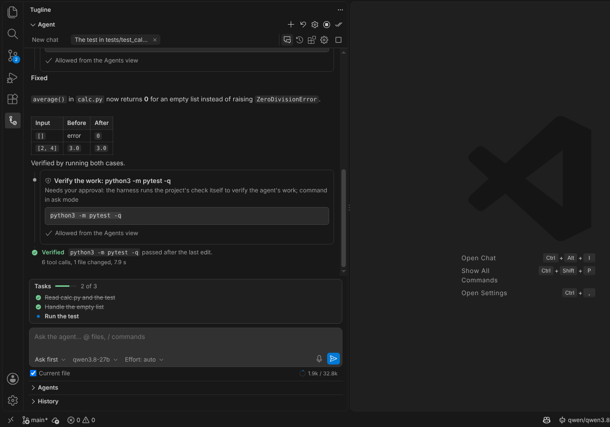
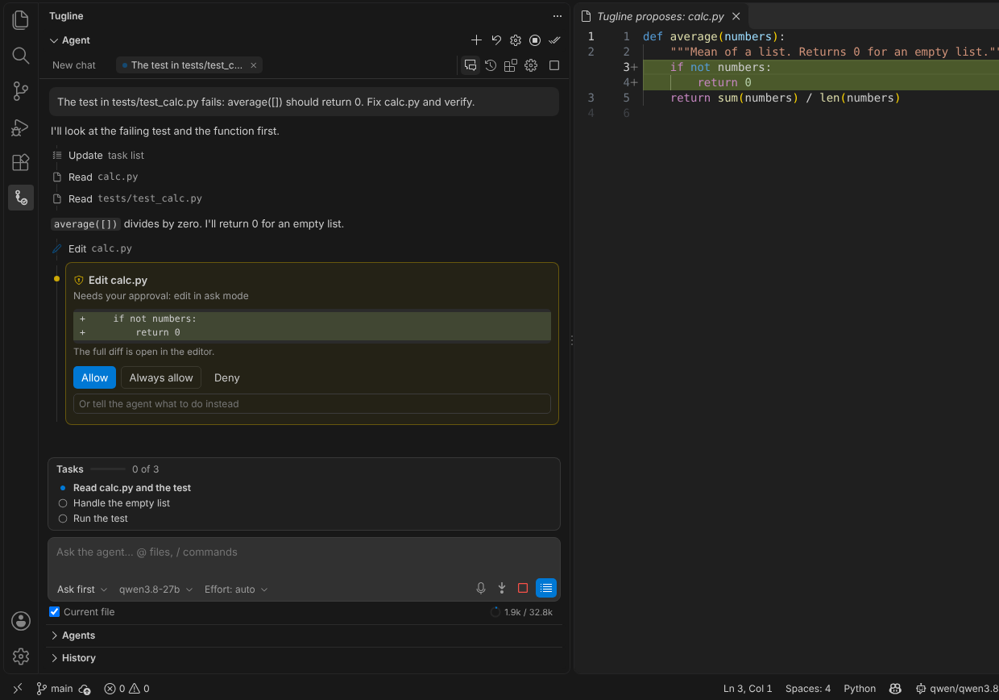
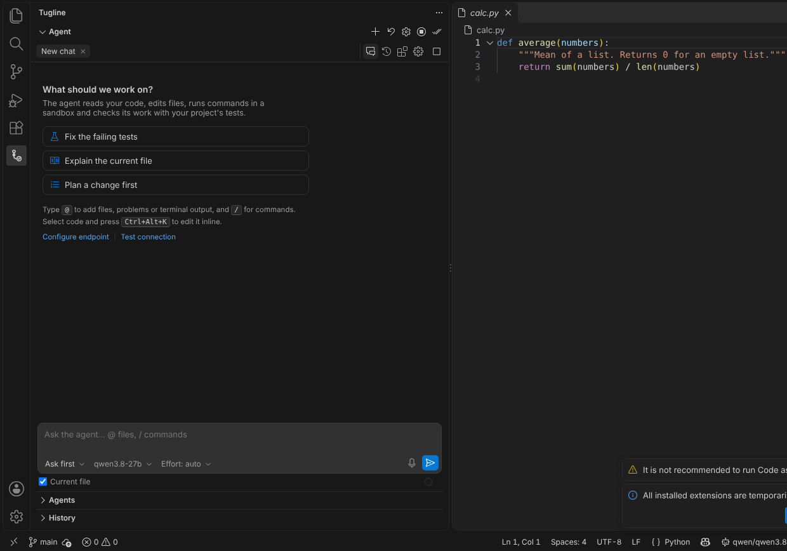

# Tugline: a coding agent for any model, in VS Code

Tugline is a coding agent that runs on **the model you choose**. It works with a local model (Ollama, LM Studio, llama.cpp, vLLM), your company's model server, or a hosted API (OpenRouter, DeepSeek or any OpenAI-compatible endpoint). It reads and edits your code, runs commands in a sandbox, and checks its own work with your project's tests before it tells you it is done.



## Why Tugline
- **Your model, your data.** It works with any OpenAI-compatible endpoint. Point it at a model on your laptop or your company's server, and your code never leaves your network.
- **Safe by default.**
  - Commands run in an OS sandbox (bubblewrap on Linux, Seatbelt on macOS), and credential folders such as `~/.ssh` and `~/.aws` are hidden.
  - The agent can never change files you protect, such as tests, CI or its own config.
  - Auto mode has a safety classifier, and a set of fixed rules that the classifier cannot override.
- **It proves its work.** A run is marked *Verified* only when your project's own check (tests, build) passes after the last edit. If no check ran, it says so in plain words.
- **Review like a pull request.** Every edit lands in the editor as a change you can keep or undo, one hunk at a time. Checkpoints let you rewind files or the conversation.



## Features
- **Chat panel:**
  - Several chats at once.
  - Queue or steer a running agent.
  - `@` to add files, problems, terminal output or a URL; `/` for commands and skills.
  - Paste images.
- **Modes:**
  - *Ask first*: approve every edit and command.
  - *Accept edits*: edits apply without asking; commands still ask.
  - *Plan*: read-only until you approve a plan.
  - *Auto*: a safety classifier approves routine steps.
  - *YOLO*: no prompts; deny rules, protected files and the sandbox still apply.
- **Editor:**
  - Inline edit on a selection (`Ctrl/Cmd+Alt+K`).
  - Next-edit suggestions and a "Fix with Tugline" quick fix.
  - Commit-message generation.
  - Notebook cells.
  - Code navigation through VS Code's language features.
- **Agents:**
  - Subagents.
  - Agent teams with a shared task board.
  - Sessions in separate git worktrees.
  - A Task Board where each card works in its own worktree.
  - An Arena that runs several models or agents on the same task and judges them with your project's check.
- **Tools:**
  - Files, terminal, web search and fetch.
  - A browser it can drive.
  - MCP servers.
  - Skills.
  - Language servers.
- **For teams:** a managed policy file can lock the endpoint and model, set deny rules and protected paths, cap daily spend, and require the sandbox. Every approval and refusal goes to a tamper-evident log.

## Get started
1. Open **Tugline** in the activity bar.
2. Run **Tugline: Configure LLM Endpoint** and pick one:
   - **Ollama / LM Studio / llama.cpp:** start the server and pick a model. The context window is read automatically.
   - **Your company's server (vLLM, SGLang, a gateway):** enter its base URL and API key.
   - **OpenRouter or another hosted API:** paste your key. It is stored in VS Code's secret storage, never in settings files.
3. Ask for something, for example "Fix the failing tests". Tugline reads the code, proposes edits, runs the tests and reports what it verified.

Models with native tool calling work best. For models without it, Tugline switches to a text tool protocol automatically.



## The CLI
The same agent runs in your terminal and in scripts:
```bash
npm install -g tugline
tug                       # interactive
tug -p "fix the failing tests" --output-format json
```

## Privacy
Tugline sends your prompts and code only to the model endpoint **you** configure. It collects no telemetry. OpenTelemetry tracing is off unless you turn it on and point it at your own collector. When the endpoint is OpenRouter, Tugline downloads OpenRouter's public price list (no key is sent) so that spending limits work.

## Settings
- **Editor settings:** under `tugline.*`.
- **Your own rules, MCP servers and skills:** `~/.tugline/config.json`.
- **Project config:** `.tugline/config.json` can only make the rules stricter, never looser.
- **Project instructions:** read from `AGENTS.md`.

## Links
- Source, issues and documentation: [github.com/pmgarg/Tugline](https://github.com/pmgarg/Tugline)
- Licence: MIT. Third-party notices: [NOTICE](NOTICE).
